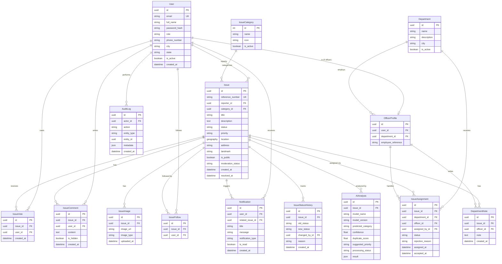

# CivicFix — Architecture & Phase 1 Plan

Nov 6, 2026 · @Smaran

First-task deliverable per the brief: validated architecture, ER diagram, app structures, API contracts, free-tier verification, risks, and the Phase 1 plan — no implementation starts until this is approved.

## System architecture

Four layers: a React SPA on Cloudflare Pages, a Django/DRF API on Render, Postgres+PostGIS and object storage on Supabase, and an optional local-only AI inference step. The frontend never talks to Postgres, Supabase Storage or the AI model directly — everything goes through the Django API, which is the one place permissions, moderation state and audit logging are enforced.

*[diagram: component architecture · 6 boxes, sync + async paths]*

Celery/Redis and the AI engine are dashed because they are **Phase 9+**, gated on confirming a free persistent worker (see the risks section) — Phases 1–8 run without them.

## Database design



This matches the 15 models in the brief one for one — no entity added or dropped. Three design points worth confirming before Phase 3, since they're easy to get wrong retroactively on a UUID-keyed schema:

- **`IssueVote` and `IssueFollow`** need a composite unique constraint on `(issue_id, user_id)` at the database level, not just application-level checks, or a race condition under concurrent requests can double-vote.
- **`IssueStatusHistory`** is append-only; `Issue.status` is a denormalized "current state" column kept in sync by the same service-layer transaction that writes the history row — never written directly from a view.
- **`DepartmentNote`** has no citizen-facing serializer path at all (not just a permission check), so a bug in a public endpoint can't leak it by omitting a filter.

## Django app structure

Eight apps, each owning its own models, serializers, permissions, `services.py` and `tasks.py`. Views stay thin: they parse the request, call a service function, and serialize the result — a status change, a vote, or an assignment is never more than a few lines of business logic away from its model, but that logic lives in `services.py`, not the view or the serializer.

| App | Owns | Key models | Notes |
| --- | --- | --- | --- |
| `accounts` | Custom user model, auth, JWT, profile | `User` | Built first — swapping the user model after the first migration is painful in Django |
| `issues` | Reporting, voting, comments, follows, status workflow | `Issue`, `IssueImage`, `IssueVote`, `IssueComment`, `IssueFollow`, `IssueStatusHistory`, `IssueCategory` | The status-transition service is the one place `old_status → new_status` is validated |
| `locations` | PostGIS helpers, nearby/radius queries | (no models of its own — wraps `Issue.location`) | Keeps raw PostGIS queries out of `issues/views.py` |
| `departments` | Departments, officer assignment | `Department`, `OfficerProfile`, `IssueAssignment`, `DepartmentNote` | Enforces department-level data isolation |
| `ai_engine` | Classification, duplicate detection, priority scoring | `AIAnalysis` | Every model call wrapped so a missing/slow model degrades to "no suggestion", never a 500 |
| `notifications` | In-app notification creation and delivery | `Notification` | Triggered by signals from `issues`/`departments`, not by views directly |
| `analytics` | Dashboard aggregates for citizen/officer/admin | (reads other apps' models) | Real DB aggregation (`annotate`/`aggregate`), no hardcoded numbers |
| `audit` | Administrative action logging | `AuditLog` | Written via a thin decorator/mixin on admin and officer actions, not scattered `AuditLog.objects.create()` calls |

`common/permissions.py` holds the three DRF permission classes (`IsCitizen`, `IsDepartmentOfficer`, `IsSuperAdmin`) plus an object-level `IsAssignedDepartment` check used by every officer endpoint — centralizing this is what makes "officers can't see other departments' issues" something you can unit test once instead of re-verifying per view.

## React frontend structure

```
src/
  routes/            # React Router route tree, one file per layout
    public.tsx        # landing, explore, public issue, public map, auth
    citizen.tsx        # dashboard, report issue, my reports, notifications, profile
    officer.tsx         # officer dashboard, assigned issues, department analytics
    admin.tsx            # admin dashboard, moderation, departments, users, audit
  layouts/            # CitizenLayout, OfficerLayout, AdminLayout, PublicLayout
  pages/              # one file per page, composed from features/ + components/
  features/           # feature-scoped logic: issues/, auth/, map/, notifications/
    issues/
      api.ts            # TanStack Query hooks calling services/
      hooks.ts
      components/        # IssueCard, IssueForm, IssueStatusBadge, PriorityBadge
  components/          # pure, reusable, no feature knowledge: Navbar, Sidebar, Pagination,
                       # FilterPanel, ConfirmationModal, LoadingSkeleton, EmptyState, ErrorState
  services/           # Axios instance + typed API client, one module per Django app
  context/             # AuthContext (JWT + role), NotificationContext
  hooks/               # useGeolocation, useDebouncedSearch, etc.
  types/               # generated/hand-written types mirroring DRF serializers
  utils/
```

Routing is role-gated at the layout level: `ProtectedRoute` reads the decoded JWT's `role` claim from `AuthContext` and redirects to the matching dashboard, so a citizen hitting an officer URL never reaches the officer components, let alone their data — but this is a UX convenience, not the security boundary; that boundary is the DRF permission classes in `common/permissions.py`, since a frontend route guard is trivially bypassed.

TanStack Query owns all server state (issues, notifications, dashboard stats); component state (form inputs, modal open/closed) stays local. Zod schemas validate the Report Issue form client-side and are the single source of truth also used to type the Axios request body, so the frontend and the DRF serializer can't silently drift apart on what a valid issue looks like.

## API contracts

The brief's endpoint list is consistent with the models and roles above and needs no restructuring. Checking it against every feature described in sections D, F and 6 of the brief surfaces four gaps — features that are specified but have no endpoint to call:

| Missing endpoint | Covers |
| --- | --- |
| `POST /issues/{id}/report/` | Citizen "report inappropriate content" on an issue (brief, issue details page) |
| `POST /comments/{id}/report/` | Same, for a comment |
| `POST /admin/comments/{id}/hide/` | Admin "review comments and flagged content" (brief, §6) — `IssueComment.is_hidden` exists as a field but nothing sets it |
| `GET /admin/issues/duplicates/` | Admin "manage duplicate reports" (brief, §6) — `/ai/duplicates/` only checks one issue against the rest, there's no queue of flagged pairs to review |

One rule, not a gap, worth pinning down before Phase 4: `PATCH /issues/{id}/` needs an explicit allow-list of which fields a citizen can edit, and only while `status == REPORTED` — title and description, never `status`, `priority`, or `category` directly. Without that allow-list enforced server-side, a generic PATCH becomes exactly the "arbitrary status update" the brief's §7 says to prevent.

## External services and free-tier limits (checked November 2026)

| Service | Used for | Confirmed free-tier limit | Risk |
| --- | --- | --- | --- |
| Cloudflare Pages | React SPA | Unlimited bandwidth for static assets; 500 builds/month, 1 concurrent; 20,000 files/site [source](https://eastondev.com/blog/en/posts/dev/20260526-cloudflare-free-limits/) | Low — comfortably covers this app |
| Render — web service | Django API | 512 MB RAM / 0.1 CPU; spins down after 15 min idle, 30–60s cold start; 100 GB bandwidth, 500 build min/month [source](https://render.com/docs/free) | Cold start is visible in a live demo — budget for it, don't try to defeat it (see note below) |
| Render — background worker | Celery | **No free instance exists for this service type**, confirmed directly on Render's own docs: "Other service types don't support Free instances" [source](https://render.com/docs/free). Cheapest is $7/month | This contradicts §11/§16's assumption that a free worker might be available — it will not be, on Render specifically |
| Supabase | Postgres + PostGIS, object storage | 500 MB database, 1 GB file storage, 5 GB egress/month, 2 free projects; **auto-pauses after 7 days of inactivity** [source](https://makerkit.dev/blog/saas/supabase-pricing) | The pause, not the 500 MB, is what will actually bite — a demo an interviewer opens after a quiet week needs a manual resume or a scheduled keep-alive ping |
| GitHub Actions | CI/CD | Public repo: unlimited. Private repo: 2,000 min/month [source](https://cicdcost.com/github-actions-pricing) | None — the brief already calls CivicFix open source, so keep the repo public and this limit doesn't apply |
| Upstash Redis | Celery broker, if adopted | 256 MB storage, 500,000 commands/month, free permanently [source](https://upstash.com/blog/upstash-vs-aws-elasticache-serverless-redis-pricing-and-performance-2026) | Workable once the worker question (above) is resolved |
| OpenStreetMap tile servers | Map tiles | No published quota, but the official policy prohibits "heavy use" without prior permission, bans bulk downloading, and warns access "may be withdrawn at any point" with no SLA [source](https://operations.osmfoundation.org/policies/vector/) | A publicly deployed, demoed app risks exactly the kind of use this policy is written against |

Two findings change the brief's own plan and need a decision before the relevant phase, not an assumption:

**Celery has no free home on Render.** This is worth stating plainly because the brief hedges ("verify worker availability... implement a simpler fallback") — the verification is now done, and the answer is no, not "maybe." Three real options for Phase 9, in order of how well they fit a ₹0 budget: (1) run AI classification, duplicate detection and notification creation **synchronously in the request cycle** instead of via Celery — slower per-request, but the brief already requires the app to work with AI processing unavailable, so a synchronous fallback path has to exist anyway, and it can be the only path; (2) accept a deliberate, approved exception to ₹0 and pay $7/month for a Starter worker; (3) look at whether a scheduled Render **Cron Job**, which does have a free tier, can poll for unprocessed issues on an interval instead of consuming a queue in real time. Recommendation: build (1) first, since it's required regardless, and only add a real worker later if the synchronous latency is actually a problem in practice.

**Raw OpenStreetMap tiles are a policy risk for a demoed, publicly reachable app**, not just a traffic one. [OpenFreeMap](https://sourceforge.net/mirror/openfreemap/) is a free, API-key-free alternative built on the same OSM data and explicitly designed for production hosting — swapping the Leaflet tile URL is a one-line change, so there's no reason to start on the discouraged source.

## Technical risks and dependencies

The Celery/worker and Supabase-pause risks are covered above. The rest:

| Risk | Why it matters | Mitigation |
| --- | --- | --- |
| **0.1 vCPU / 512 MB is too little to run PyTorch/Hugging Face inference in the same process as the Django API** | The brief already says "run AI inference locally during development" — that instinct is correct, and the free-tier numbers above confirm it's not just caution: 0.1 vCPU can't absorb a CNN forward pass without stalling every other request on the same service | AI inference never runs inside the Render web service in production. Phase 7 ships with inference as a pluggable, swappable step that's a no-op (or your local machine, via an admin-only trigger) in the ₹0 deployment — this is also exactly what "the app must work with AI unavailable" already requires, so no extra design cost |
| **A generic pretrained image classifier may not reliably separate potholes from garbage from streetlights** | The brief flags this correctly in §7 — there's no labelled civic-issue dataset yet | Ship as a suggestion with a visible confidence score and one-tap manual override from day one, never a silent auto-assigned category; treat fine-tuning as a stretch goal gated on first collecting real labelled reports |
| **PostGIS on Supabase's free tier isn't contractually guaranteed to be pre-enabled** | A geography-typed `Issue.location` column and every "nearby issues" query depend on it | Verify by running `CREATE EXTENSION IF NOT EXISTS postgis;` against the actual free project in Phase 2, before any model migration depends on it — don't assume |
| **A generic PATCH endpoint, or a permissive serializer, can become the "arbitrary status update" §7 explicitly prohibits** | Security requirement, not just a REST convention | Status changes only via the dedicated service-layer transitions in §7 of the brief; `IssueSerializer` never exposes `status` as a writable field |
| **Scope creep** | The brief's own §19 calls this out, and a 20-section brief this detailed is easy to over-build from | Phases 1–8 ship with no Celery, no Redis, no Channels, no fine-tuned model — exactly as §11 already says, and this plan holds to that even where later phases get tempting |
| **Seeded demo data becoming fabricated dashboard numbers** | §17 explicitly prohibits hardcoded stats, but an interviewer needs *something* to look at on a quiet project | A seed script (Django management command) creates real rows — real `Issue`, `IssueVote`, `IssueStatusHistory` records for a handful of actual Indore locations — so every dashboard number is a real aggregate query result, just over seeded data instead of organic traffic |

## Development roadmap

The brief's 12 phases roll up into four waves, each gated by the brief's own rule in §19: run it, test it, review it, only then move on.

*[diagram: roadmap · 4 waves, 12 phases, gated by review + test]*

No gate has a fixed date — each one opens only when the phase before it runs, is tested, and is reviewed, per §19. Phase 1 is this document; it's done when you approve it.

## Phase 1 implementation plan (Django foundation + auth)

This is what starts once you approve the architecture above — nothing before that. There's no existing repository to inspect yet, so this phase begins from an empty directory; if that's wrong (an existing CivicFix codebase exists somewhere), say so before this starts, since the brief itself requires inspecting what's there first rather than assuming a blank slate.

1. **Repo + project skeleton** — `backend/` with `manage.py`, `config/settings/{base,development,production}.py`, `config/urls.py`, the eight empty Django apps from the app-structure section, `requirements/{base,dev,prod}.txt`, `.env.example`, `docker-compose.yml`, `Dockerfile`.
2. **Local Postgres + PostGIS via Docker Compose**, not Supabase, for this phase — fast local iteration without touching the 500 MB/7-day-pause free project until deployment actually needs it. Confirms the PostGIS risk flagged above in a container you control before trusting it to Supabase's hosted version in Phase 2's later work.
3. **Custom `User` model in `accounts`**, created and migrated *before* any other app's models — the brief is explicit that this is hard to undo later, and it's correct.
4. **JWT auth**: `djangorestframework-simplejwt` wired for access + refresh tokens with rotation, `POST /auth/register/`, `POST /auth/login/`, `POST /auth/token/refresh/`, `GET/PATCH /auth/profile/`.
5. **`common/permissions.py`** skeleton: `IsCitizen`, `IsDepartmentOfficer`, `IsSuperAdmin` — built now even though only citizen auth exists yet, so every later app imports from one place instead of re-inventing role checks.
6. **drf-spectacular** wired for live Swagger/OpenAPI docs at `/api/v1/schema/swagger-ui/` — cheap to add now, and every endpoint from here on documents itself.
7. **Pytest + pytest-django**, with tests for: registration (including the email-uniqueness and password-strength rules), login, token refresh and rotation, and that each permission class actually blocks the roles it should.

**How we verify this phase before moving to Phase 2** (per the brief's own rule in §19): `docker compose up`, run the Pytest suite and paste the output, hit `/auth/register/` → `/auth/login/` → `/auth/profile/` with a real HTTP client (curl, HTTPie, or the Swagger UI) and confirm the token round-trip actually works, and confirm migrations apply cleanly against a fresh database. Nothing in this phase is reported done without that evidence attached.

## Open questions and approval checklist

Four decisions need your call, not mine, before Phase 1 code starts:

- **Celery/Redis**: build the synchronous fallback first and defer a real worker (recommended), or approve the $7/month Starter worker as a deliberate exception to ₹0 now?
- **Map tiles**: switch to OpenFreeMap instead of `tile.openstreetmap.org`, given the official policy risk above?
- **The four API gaps** (report content, hide comments, review duplicates, and the `PATCH /issues/{id}/` field allow-list) — add them as specified, or do you want them scoped differently?
- **Existing code**: confirm there's genuinely nothing to inspect yet, so Phase 1 can start from an empty repo.

From the brief's own milestone tracker, this document is meant to close out:

- [ ] Claude understands the complete requirements
- [ ] Database ER diagram finalized
- [ ] Django backend structure finalized
- [ ] React frontend structure finalized
- [ ] API contracts finalized
- [ ] Free deployment architecture verified
